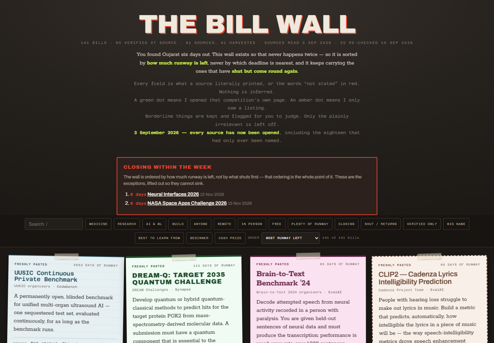
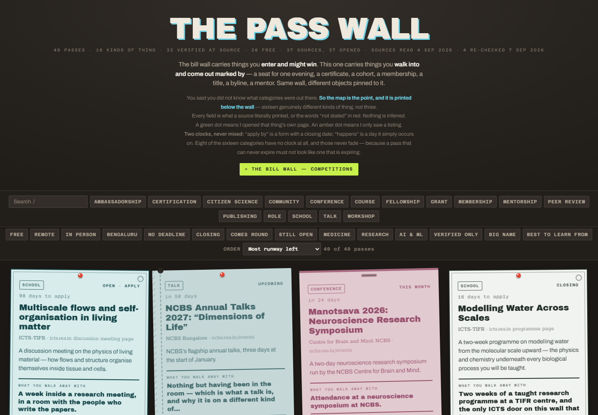

# Competition Radar

## Find the opportunity while you still have time to do something about it.

I found the Gujarat Police competition six days before its deadline. I wanted a month. That is why I built these two walls.

One is for things you can enter and win. The other is for fellowships, workshops and research communities you might never hear about until somebody else gets in.

**[Open the Bill Wall](https://arnav-agarwal137.github.io/competition-radar/bills/) · [Open the Pass Wall](https://arnav-agarwal137.github.io/competition-radar/passes/)**

You can use both in a browser, on your phone or laptop. You do not need an account or an installation.

## The Bill Wall

### Competitions worth having a head start on

[](https://arnav-agarwal137.github.io/competition-radar/bills/)

A list sorted by the nearest deadline often gives you the least useful opportunity first: the one you cannot prepare for anymore. The Bill Wall starts with how much time you have left to build something.

Each competition has its own poster: what it is, who can enter, fees, team rules, reward, deadline and the original source. My opinion about difficulty and whether it is worth doing sits beside those facts, clearly labelled.

Filter for medicine, research, AI, beginner-friendly work, remote entries or cash prizes. Sort by time left, usefulness, prestige or what you would learn. The published demo contains **141 bills**.

## The Pass Wall

### There are more doors into a field than competitions

[](https://arnav-agarwal137.github.io/competition-radar/passes/)

A research workshop, a fellowship, a community, a mentor, a chance to review a paper: these are different ways to get involved, and I wanted them on the same map.

The Pass Wall covers **16 kinds of opportunity**, with **49 passes in the published demo**. It separates the application deadline from the date of the event. Things you can join any time stay visible without pretending they are about to expire.

## Try it in a minute

1. Open either wall above.
2. Type a subject or organisation into search. Press `/` to jump there and `Escape` to clear it.
3. Add filters such as **Remote**, **Free** or **Verified only**.
4. Open a poster, read the details and follow its official source before applying.

The countdowns use your browser's date, but the underlying facts are a published snapshot. **The source-check dates shown on the demo are September 2026.** A live countdown does not mean an opportunity has been freshly verified. Recheck deadlines, eligibility and fees with the organiser.

## What makes a listing trustworthy?

A green mark means the opportunity's own source was opened. An amber mark means the information came from a listing. A missing requirement says **not stated** rather than silently turning into a guess.

I learned to care about this because an aggregator called a closed competition active, another page served perfectly formatted events from years earlier, and a prize was once read much too large. Verification is a bigger part of this project than the poster layout.

The selection and commentary were written around my interests in medicine, research and building software, with a focus on India. Use that judgement as a starting point, then make your own call.

## For builders

The pages are static HTML, CSS and JavaScript. Python scripts assemble the entries and render the walls. Search and filters run in your browser; opening a listing does not submit an application.

```text
src/bills_*.py       Competition entries
src/passes.py        Other opportunities
src/data.py          Bill assembly and validation
src/judgement*.py    Separate editorial opinions
src/build*.py        Page generators
bills/index.html    Published Bill Wall
passes/index.html   Published Pass Wall
```

The generators write `src/radar.html` and `src/passes.html`; deployed copies live under `bills/` and `passes/`. Data, opinion and rendering stay separate so a layout change does not quietly change a claim.

To explore a local copy, download the repository and open either published `index.html`. The built pages carry their entries in the file and can be browsed offline; visiting sources still needs internet.

[Report a correction](https://github.com/Arnav-Agarwal137/competition-radar/issues) with the official source and the field that needs changing.

Built by [Arnav Agarwal](https://github.com/Arnav-Agarwal137). [More projects](https://arnav-agarwal137.github.io/).

## Licence

Free noncommercial use and private improvements are permitted for newly licensed original work.
Share the official links freely. Redistributing copies, publishing modified versions, public mirrors,
rebranding, and commercial use require Arnav Agarwal's prior written permission.
Keep authorship and required notices. This is a source-available custom licence, not an open-source licence.
Earlier licence grants and third-party rights remain in force; see [LICENSE-HISTORY.md](LICENSE-HISTORY.md).
Previously published source, embedded app notices, tags and downloadable binaries retain their earlier grants;
this policy does not retroactively prohibit their previously permitted use or distribution.

Full terms: [LICENSE](LICENSE). Permission requests: [GitHub issues](https://github.com/Arnav-Agarwal137/competition-radar/issues).

Check every deadline at its official source before acting on it.

Built by [Arnav Agarwal](https://github.com/Arnav-Agarwal137).
